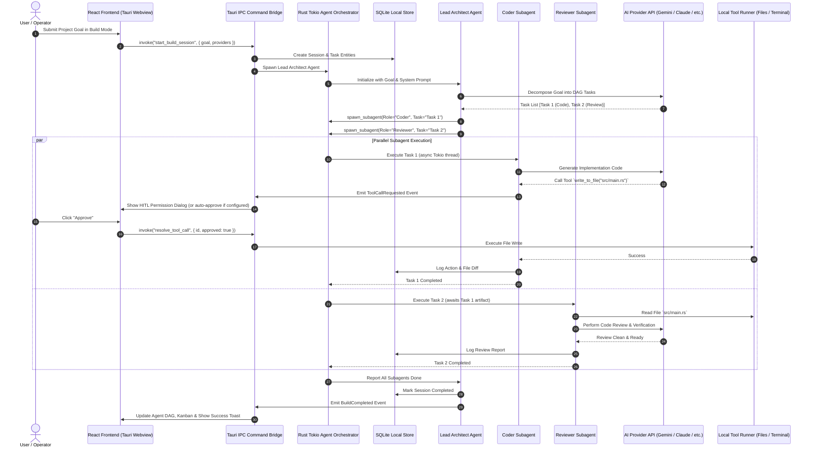

# Implementation Plan: Autonomous AI Native Hub (Windows & Linux)

A native desktop application built with **Tauri 2.0 (Rust) + React 19 (TypeScript) + Framer Motion** that acts as a unified hub for personal AI workflows. It seamlessly supports three primary modes: **Chatbot Mode**, **Agent Mode**, and **Build Mode** (parallel multi-agent collaboration with recursive subagent spawning), powered by user-provided API keys (Google Gemini, OpenAI, Anthropic Claude, DeepSeek, Groq, Ollama, and Custom Endpoints).

---

## Architecture & Data Flow

---

## 4 Mandatory Boundary States (AetherCraft Protocol)

Setiap dynamic view wajib memiliki:
1. **Loading Skeleton**: Shimmering layout placeholders matching exact element proportions.
2. **Empty State**: Zero-state guides with actionable CTA.
3. **Error Boundary + Retry**: Runtime error catch with one-click diagnostic and retry.
4. **Success Toast / Feedback**: Tactile toast notification upon completion.
